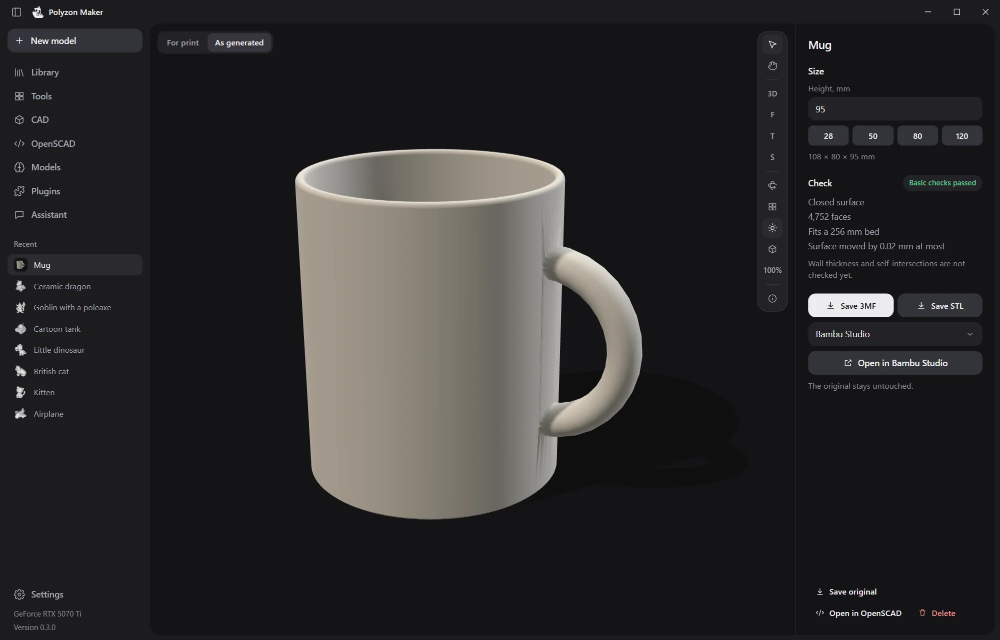
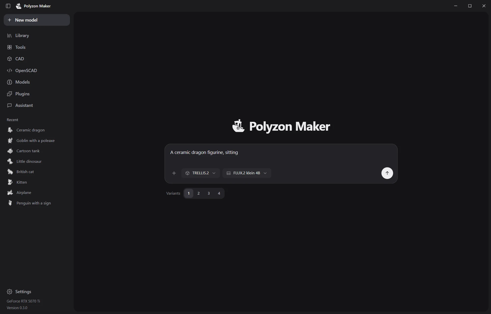
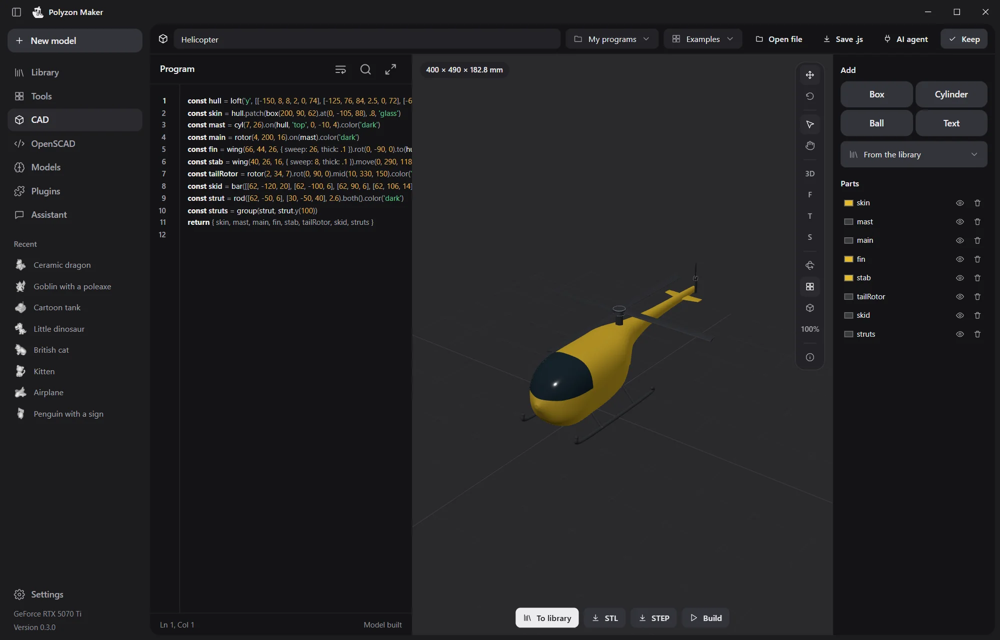
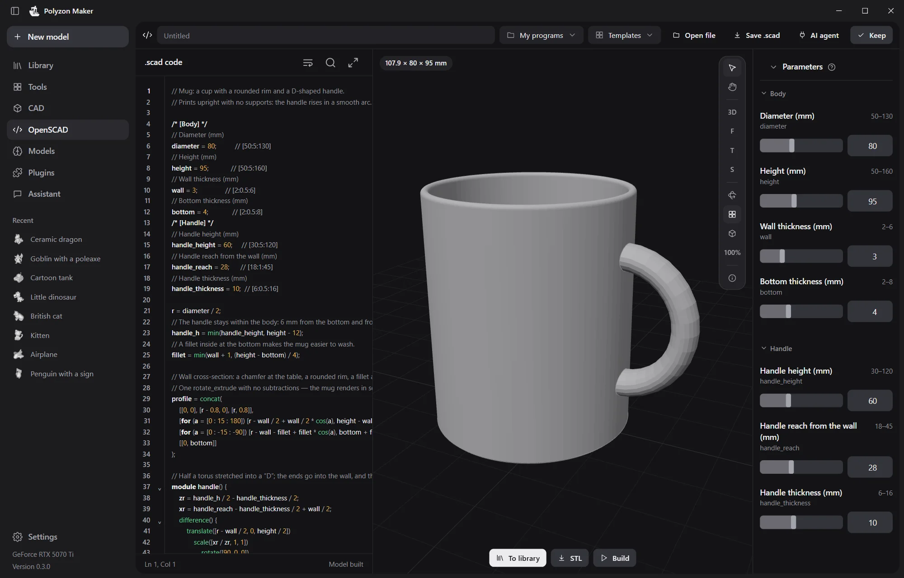
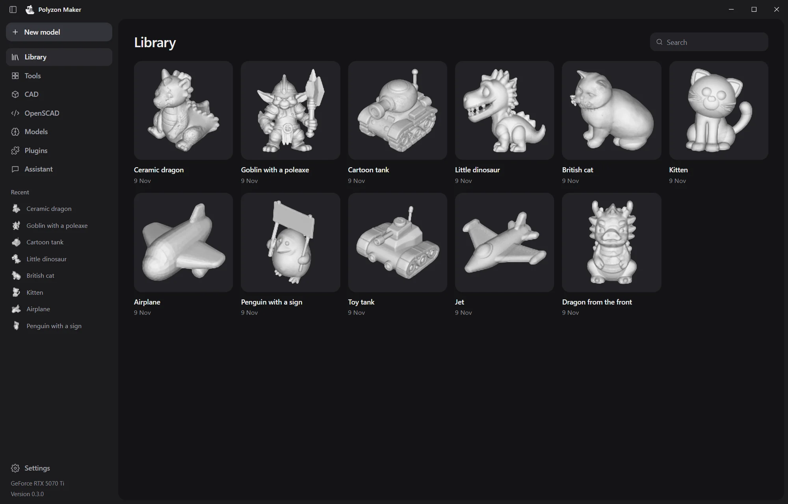
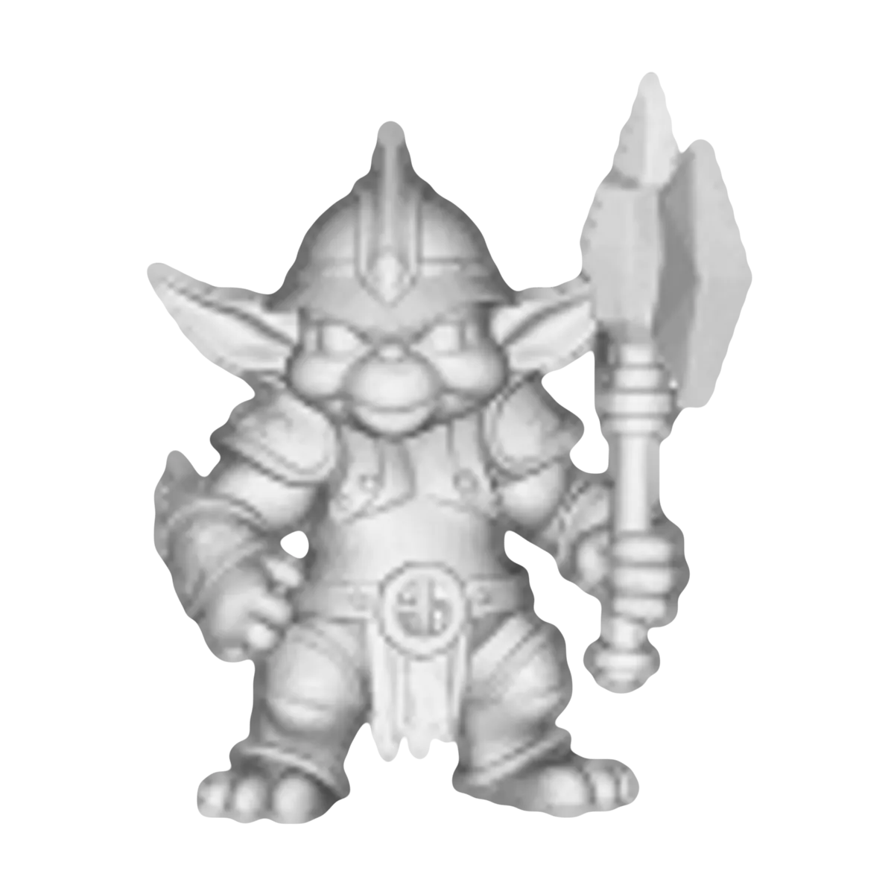
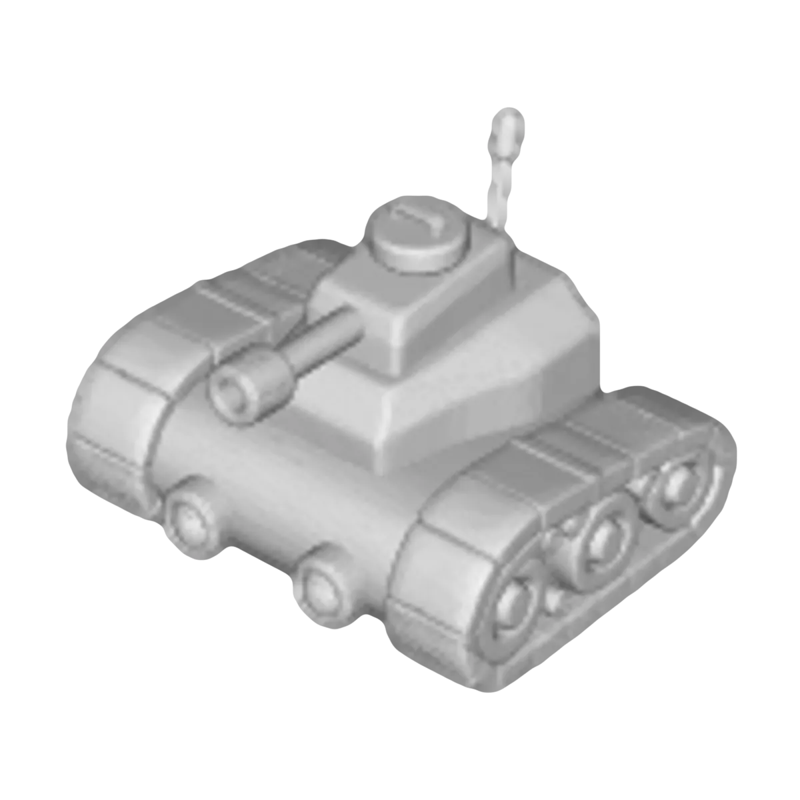
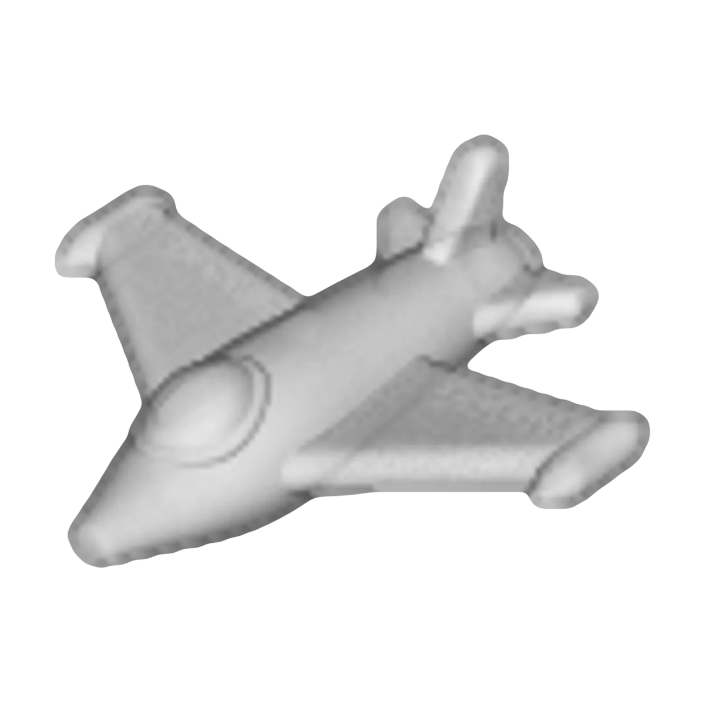

<p align="center">
  <picture>
    <source media="(prefers-color-scheme: dark)" srcset="docs/images/boat-dark.svg">
    
  </picture>
</p>

<h1 align="center">Polyzon Maker</h1>

<p align="center">
  Turn a photo or a few words into a 3D model on your own computer,<br>
  then get it ready to print.
</p>

<p align="center">
  <a href="https://github.com/PolyzonOrg/PolyzonMaker/releases/latest"></a>
  <a href="LICENSE"></a>
  
</p>

<p align="center">
  <a href="https://github.com/PolyzonOrg/PolyzonMaker/releases/latest"><b>Download</b></a> ·
  <a href="https://maker.polyzon.org/en/">Website</a> ·
  <a href="README.ru.md">Русский</a>
</p>

<p align="center">
  
</p>

Polyzon Maker runs open AI models for 3D on your computer. No account, no subscription, and no limits set by us. It downloads the model you pick, generates the shape, checks it, and hands a ready STL or 3MF to your slicer.

## What it does

- **Photo to 3D.** Drop a picture and pick a model. TRELLIS.2, Hunyuan3D, TripoSG and TripoSR are in the catalog, and the first run checks what fits this computer and how long each takes.
- **Words to 3D.** A local picture model (Z-Image Turbo or FLUX.2 klein) draws the object first, then a 3D model builds it.
- **Several photos to the real shape.** MapAnything, Pi3, VGGT and Hunyuan3D-2mv take shots from different sides.
- **Ready to print.** Height in millimetres, a closed surface, a check that it fits the bed. Save 3MF or STL, or open it straight in Bambu Studio, OrcaSlicer, PrusaSlicer, UltiMaker Cura, ElegooSlicer or Anycubic Slicer Next. The original stays untouched.
- **A queue for the night.** Generations run one after another. You can pause the queue, and when it is done you get a notice. You can also have the computer go to sleep or shut down, after a minute in which you can say no.
- **101 tools** for printable things: Gridfinity bins, boxes, gears, vases, hooks, signs, Braille plates and more.
- **CAD and OpenSCAD**, with a local assistant that writes the code, looks at the result and fixes it.
- **AI agents over MCP.** Claude Code, Codex, Cursor and other agents can make and check models in the program. See [API.md](apps/desktop/API.md).
- **Plugins.** A plugin can add a page, a panel, a command, a theme or an AI model the program does not run yet. Each one runs apart from the program, with only the permissions you grant. See [PLUGINS.md](apps/desktop/PLUGINS.md).

<table>
  <tr>
    <td></td>
    <td></td>
  </tr>
  <tr>
    <td></td>
    <td></td>
  </tr>
</table>

## Made with it

<table>
  <tr>
    <td></td>
    <td></td>
    <td></td>
    <td></td>
    <td></td>
    <td></td>
  </tr>
</table>

## Download

| System | File | Notes |
| --- | --- | --- |
| Windows 10 and 11, x64 | `Polyzon-Maker_<version>_x64-setup.exe` | The installer is not code-signed yet, so SmartScreen may ask once: «More info», then «Run anyway». |
| macOS 12 or later, Apple Silicon | `Polyzon-Maker_<version>_aarch64.dmg` | Not signed by Apple yet: see below. |
| macOS 12 or later, Intel | `Polyzon-Maker_<version>_x64.dmg` | Not signed by Apple yet: see below. |
| Linux x64 | `Polyzon-Maker_<version>_amd64.AppImage` or `.deb` | Built on Ubuntu 22.04. The `.deb` needs `libwebkit2gtk-4.1-0`. |

All files are on the [releases page](https://github.com/PolyzonOrg/PolyzonMaker/releases/latest) and on [maker.polyzon.org](https://maker.polyzon.org/en/). On Windows and Linux the program updates itself, and every update is checked against the project's signing key before it goes in. The macOS builds do not update themselves yet.

**Opening an unsigned build on a Mac.** The first time, macOS refuses to open it. Go to System Settings → Privacy & Security and press «Open Anyway». Or run this once in Terminal:

```sh
xattr -dr com.apple.quarantine "/Applications/Polyzon Maker.app"
```

## AI models

The program downloads model weights from their authors on Hugging Face only when you ask for a model. Each model keeps its own license, and the program shows it before the download.

| Model | Makes | License |
| --- | --- | --- |
| TRELLIS.2 (through trellis.cpp) | a 3D model from a photo | MIT, DINOv3 terms |
| Pixal3D | a 3D model from a photo | MIT, DINOv3 terms |
| Hunyuan3D-2 mini Turbo, 2, 2.1, 2mv | a 3D model from a photo or several | Tencent Hunyuan Community: not offered in the EU, the UK and South Korea |
| TripoSG, TripoSR | a 3D model from a photo | MIT |
| MapAnything | a real-size shape from several photos | Apache-2.0 |
| Pi3, VGGT | a real-size shape from several photos | CC BY-NC 4.0: no commercial use |
| Z-Image Turbo, FLUX.2 klein 4B | a picture from words | Apache-2.0 |
| Gemma 4, Qwen3.6 | the assistant's text | Apache-2.0 |

Beyond the catalog, the Models page searches Hugging Face for other text models.

**What has been tested.** TRELLIS.2, Hunyuan3D-2 mini, TripoSG, TripoSR and both picture models have run on Windows with an NVIDIA card. TRELLIS.2, TripoSG, TripoSR and Hunyuan3D-2 mini also have a processor route on Windows, which is much slower: queue them for the night. Everything else, and every model on macOS and Linux, is marked experimental in the program until it has run there.

## Privacy

The models run on your computer, and your pictures and models stay there. The program sends nothing on its own except a look for updates at start. Anonymous reports, which hold short codes only and no files or text, go out only if you agree to them, and you can turn both off in Settings.

## Build from source

The build fetches its own pinned Rust and Node. On Windows it installs the Microsoft C++ Build Tools through winget. macOS needs the Xcode Command Line Tools. Linux needs the WebKitGTK development packages listed in [`linux.yml`](.github/workflows/linux.yml).

```sh
git clone https://github.com/PolyzonOrg/PolyzonMaker
cd PolyzonMaker/apps/desktop
sh build.sh        # macOS and Linux
BUILD.cmd          # Windows
```

The installer lands in `apps/desktop/release/`. To work on the interface in a browser, with a stand-in core, run `npm install` and `npm run dev`. Checks: `npm test`, `npm run check`, and `cargo test` in `src-tauri/`. [apps/desktop/README.md](apps/desktop/README.md) has more.

## Inside

| Folder | What it is |
| --- | --- |
| [`apps/desktop`](apps/desktop) | The program: Tauri 2, Svelte 5 and a small Rust core |
| [`packages/mesh-kit`](packages/mesh-kit) | Print preparation: repair, closed surface, size, base, STL and 3MF |
| [`tools/bench`](tools/bench) | The engine runner the program uses, and the hardware benchmark behind its time estimates |
| [`tools/tauri-probe`](tools/tauri-probe) | Fetches the pinned Rust and Node for the build; also the first check of the 3D view on each system |
| [`tools/plugin-*`](tools) | Example plugins: a page, an AI model, a theme |

## License

The code is under the [MIT license](LICENSE). Bundled parts keep their own licenses. Each is a separate file with its notice:

- OpenSCAD for WebAssembly: GPL-2.0 or later ([NOTICE](apps/desktop/public/openscad/NOTICE.txt));
- OpenCascade through replicad: LGPL-2.1 with the OCCT exception; Manifold: Apache-2.0 ([NOTICE](apps/desktop/public/cad/NOTICE.txt));
- the tool fonts: SIL OFL 1.1 and Apache-2.0 ([list](apps/desktop/public/tool-fonts/README.md)).

AI models are not part of this repository and keep their authors' licenses.

Made by [Polyzon](https://polyzon.org).
