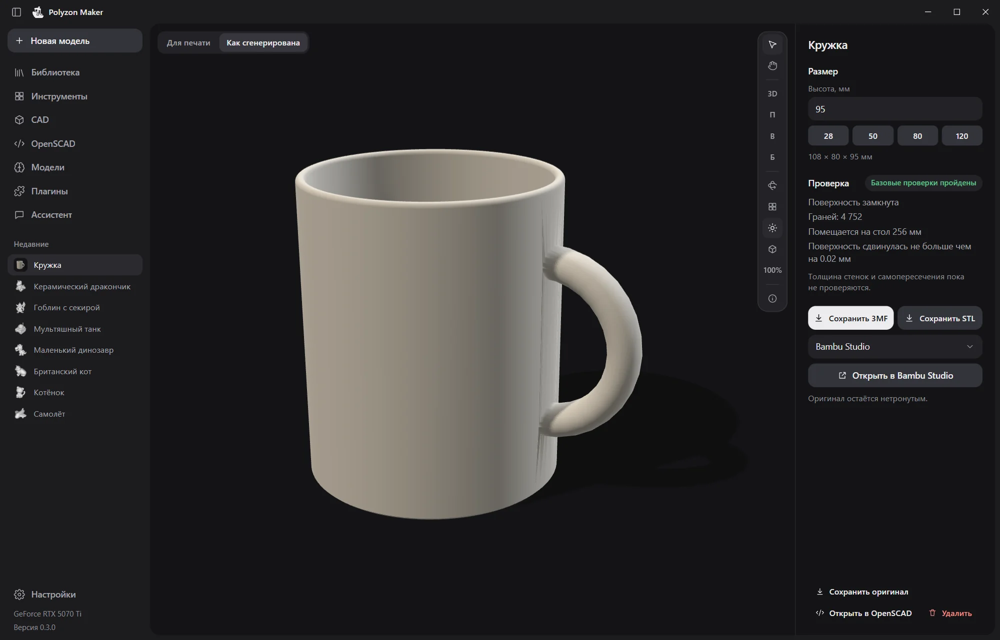
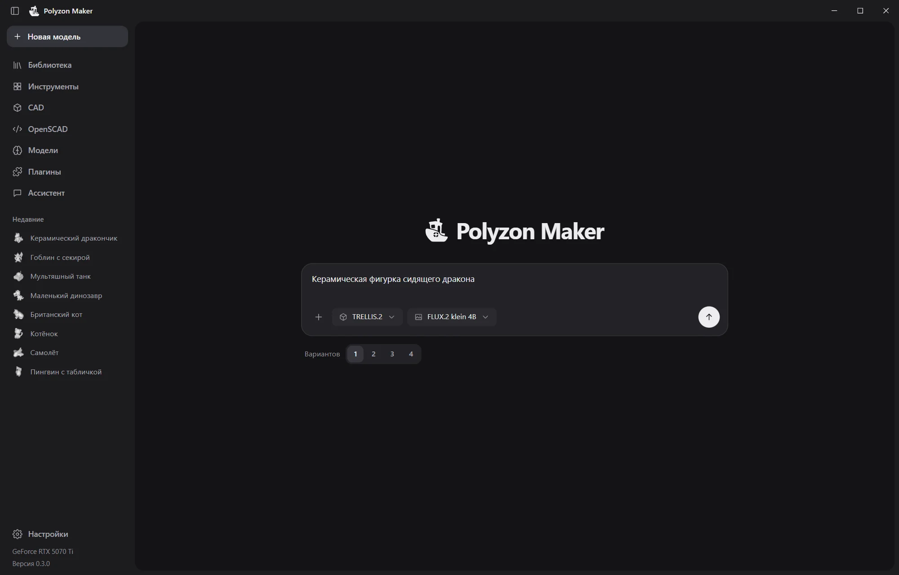
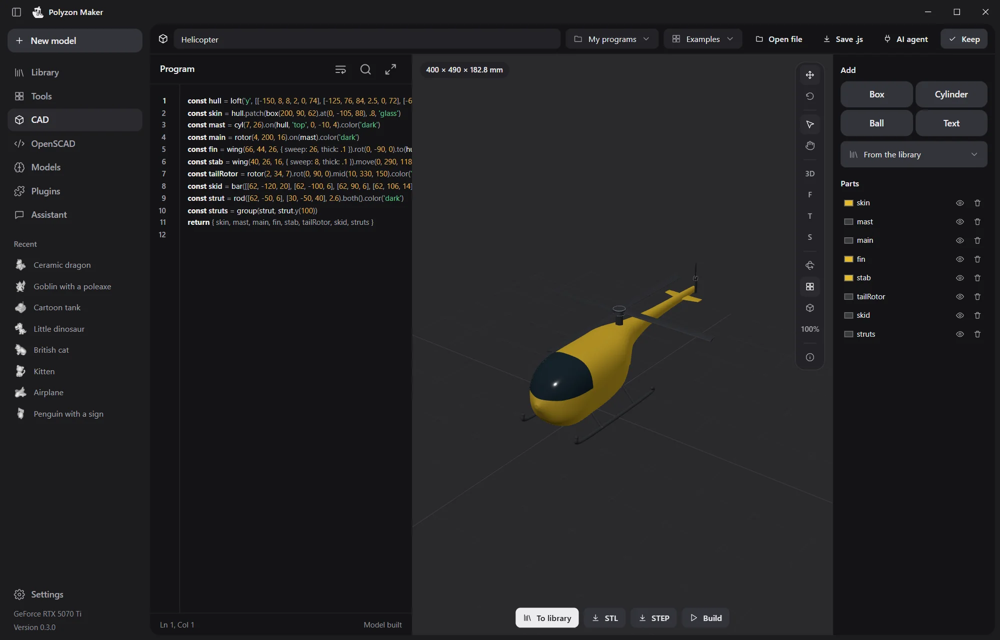
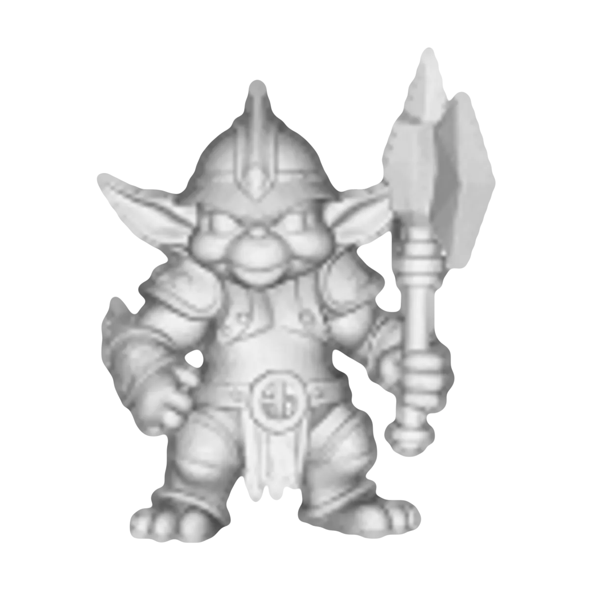
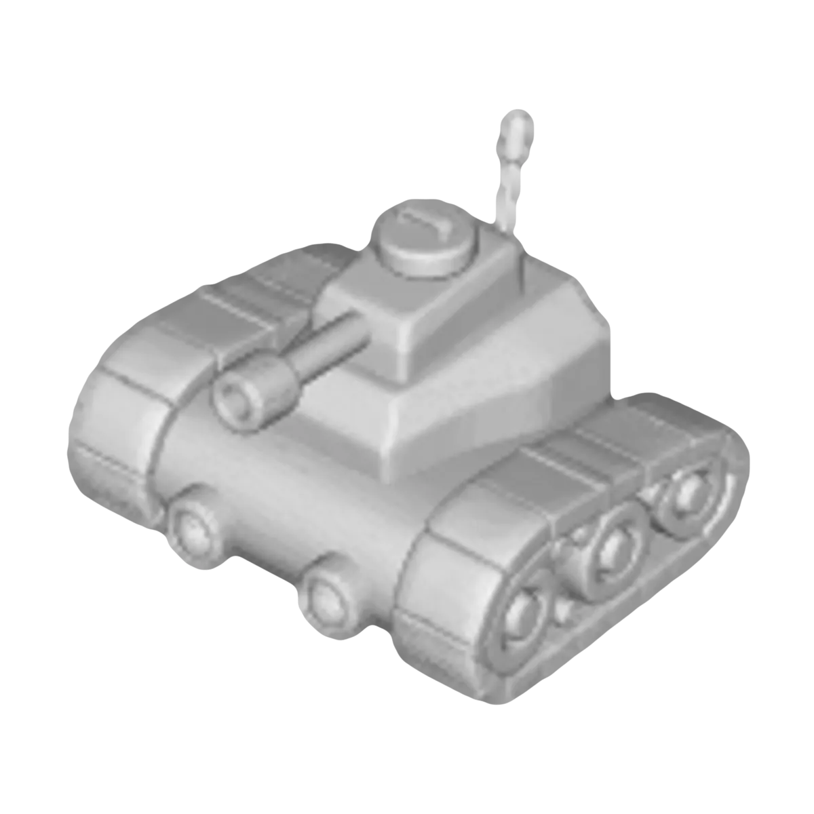
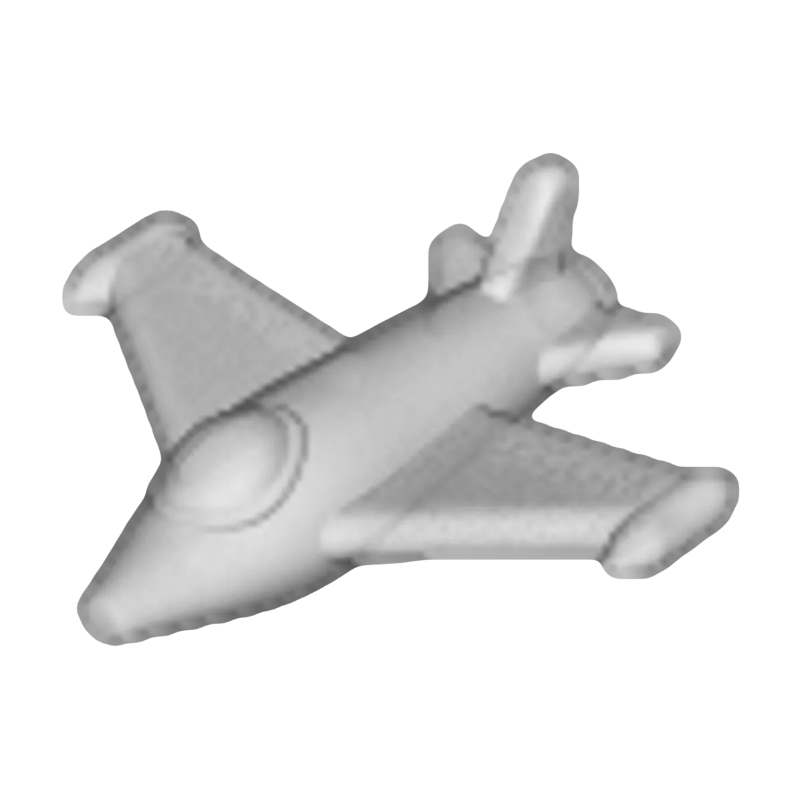

<p align="center">
  <picture>
    <source media="(prefers-color-scheme: dark)" srcset="docs/images/boat-dark.svg">
    
  </picture>
</p>

<h1 align="center">Polyzon Maker</h1>

<p align="center">
  3D-модели из фото и слов прямо на вашем компьютере,<br>
  сразу готовые к печати.
</p>

<p align="center">
  <a href="https://github.com/PolyzonOrg/PolyzonMaker/releases/latest"></a>
  <a href="LICENSE"></a>
  
</p>

<p align="center">
  <a href="https://github.com/PolyzonOrg/PolyzonMaker/releases/latest"><b>Скачать</b></a> ·
  <a href="https://maker.polyzon.org/">Сайт</a> ·
  <a href="README.md">English</a>
</p>

<p align="center">
  
</p>

Polyzon Maker запускает открытые ИИ-модели для 3D у вас на компьютере. Без аккаунта, без подписки и без наших ограничений. Программа скачивает выбранную модель, строит форму, проверяет её и передаёт готовый STL или 3MF в ваш слайсер.

## Что умеет

- **Фото → 3D.** Перетащите картинку и выберите модель: в каталоге TRELLIS.2, Hunyuan3D, TripoSG и TripoSR. При первом запуске программа проверяет компьютер и показывает, что на нём пойдёт и сколько займёт.
- **Слова → 3D.** Сначала локальная модель картинок (Z-Image Turbo или FLUX.2 klein) рисует предмет, потом 3D-модель его строит.
- **Несколько фото → настоящая форма.** MapAnything, Pi3, VGGT и Hunyuan3D-2mv собирают её по снимкам с разных сторон.
- **Готово к печати.** Высота в миллиметрах, замкнутая поверхность, проверка, что модель влезает на стол. Можно сохранить 3MF или STL или сразу открыть в Bambu Studio, OrcaSlicer, PrusaSlicer, UltiMaker Cura, ElegooSlicer или Anycubic Slicer Next. Исходник остаётся нетронутым.
- **Очередь на ночь.** Генерации идут одна за другой. Очередь можно поставить на паузу, а когда она закончится, придёт уведомление. Можно попросить программу усыпить или выключить компьютер: перед этим у вас будет минута, чтобы отказаться.
- **101 инструмент** для печатных вещей: ящики Gridfinity, коробки, шестерни, вазы, крючки, таблички, надписи шрифтом Брайля и другое.
- **CAD и OpenSCAD** с локальным ассистентом: он пишет код, смотрит на результат и исправляет.
- **ИИ-агенты через MCP.** Claude Code, Codex, Cursor и другие агенты могут делать и проверять модели в программе, см. [API.md](apps/desktop/API.md).
- **Плагины.** Плагин может добавить страницу, панель, команду, тему или ИИ-модель, которую программа пока не запускает. Плагин работает отдельно от программы и только с теми правами, которые вы ему дали, см. [PLUGINS.md](apps/desktop/PLUGINS.md).

<table>
  <tr>
    <td></td>
    <td></td>
  </tr>
</table>

## Сделано в программе

<table>
  <tr>
    <td></td>
    <td></td>
    <td></td>
    <td></td>
    <td></td>
    <td></td>
  </tr>
</table>

## Скачать

| Система | Файл | Что знать |
| --- | --- | --- |
| Windows 10 и 11, x64 | `Polyzon-Maker_<версия>_x64-setup.exe` | У установщика пока нет цифровой подписи, поэтому SmartScreen может один раз спросить: «Подробнее», затем «Выполнить в любом случае». |
| macOS 12 и новее, Apple Silicon | `Polyzon-Maker_<версия>_aarch64.dmg` | Пока без подписи Apple, см. ниже. |
| macOS 12 и новее, Intel | `Polyzon-Maker_<версия>_x64.dmg` | Пока без подписи Apple, см. ниже. |
| Linux x64 | `Polyzon-Maker_<версия>_amd64.AppImage` или `.deb` | Собрано на Ubuntu 22.04. Для `.deb` нужен `libwebkit2gtk-4.1-0`. |

Все файлы лежат на [странице релизов](https://github.com/PolyzonOrg/PolyzonMaker/releases/latest) и на [maker.polyzon.org](https://maker.polyzon.org/). На Windows и Linux программа обновляется сама и перед установкой проверяет каждое обновление по ключу проекта. Версия для Mac сама пока не обновляется.

**Как открыть версию без подписи на Mac.** В первый раз macOS откажется её запускать. Откройте «Системные настройки» → «Конфиденциальность и безопасность» и нажмите «Всё равно открыть». Или один раз выполните в Терминале:

```sh
xattr -dr com.apple.quarantine "/Applications/Polyzon Maker.app"
```

## ИИ-модели

Веса моделей программа скачивает с Hugging Face, у их авторов, и только когда вы сами выбрали модель. У каждой модели своя лицензия, и программа показывает её до скачивания.

| Модель | Что делает | Лицензия |
| --- | --- | --- |
| TRELLIS.2 (через trellis.cpp) | 3D-модель по фото | MIT и условия DINOv3 |
| Pixal3D | 3D-модель по фото | MIT и условия DINOv3 |
| Hunyuan3D-2 mini Turbo, 2, 2.1, 2mv | 3D-модель по одному или нескольким фото | Tencent Hunyuan Community: недоступна в ЕС, Великобритании и Южной Корее |
| TripoSG, TripoSR | 3D-модель по фото | MIT |
| MapAnything | настоящая форма и размер по нескольким фото | Apache-2.0 |
| Pi3, VGGT | настоящая форма и размер по нескольким фото | CC BY-NC 4.0: только некоммерческое использование |
| Z-Image Turbo, FLUX.2 klein 4B | картинка по словам | Apache-2.0 |
| Gemma 4, Qwen3.6 | текст ассистента | Apache-2.0 |

Кроме каталога, на странице «Модели» можно найти на Hugging Face и другие текстовые модели.

**Что проверено.** TRELLIS.2, Hunyuan3D-2 mini, TripoSG, TripoSR и обе модели картинок работали на Windows с видеокартой NVIDIA. У TRELLIS.2, TripoSG, TripoSR и Hunyuan3D-2 mini на Windows есть и путь на процессоре: он намного медленнее, такие генерации лучше ставить на ночь. Все остальные модели, а на macOS и Linux вообще все, программа помечает как экспериментальные, пока они там не проверены.

## Приватность

Модели работают на вашем компьютере, и ваши картинки и модели остаются у вас. Сама программа отправляет только запрос проверки обновлений при запуске. Анонимные отчёты уходят, только если вы на них согласились: в них короткие коды, без файлов и текста. И то и другое отключается в настройках.

## Собрать самому

Сборка сама скачивает закреплённые версии Rust и Node. На Windows она ставит Microsoft C++ Build Tools через winget. На macOS нужны Xcode Command Line Tools. На Linux нужны пакеты разработки WebKitGTK из [`linux.yml`](.github/workflows/linux.yml).

```sh
git clone https://github.com/PolyzonOrg/PolyzonMaker
cd PolyzonMaker/apps/desktop
sh build.sh        # macOS и Linux
BUILD.cmd          # Windows
```

Установщик окажется в `apps/desktop/release/`. Чтобы работать над интерфейсом в браузере, с подменой ядра, выполните `npm install` и `npm run dev`. Проверки: `npm test`, `npm run check` и `cargo test` в `src-tauri/`. Подробнее в [apps/desktop/README.md](apps/desktop/README.md).

## Лицензия

Код распространяется по [лицензии MIT](LICENSE). У встроенных частей свои лицензии, у каждой есть отдельный файл с уведомлением: OpenSCAD — GPL-2.0 или новее, OpenCascade — LGPL-2.1 с исключением OCCT, Manifold — Apache-2.0, шрифты инструментов — SIL OFL 1.1 и Apache-2.0. ИИ-модели не входят в этот репозиторий, на них действуют лицензии их авторов.

Сделано в [Polyzon](https://polyzon.org).
